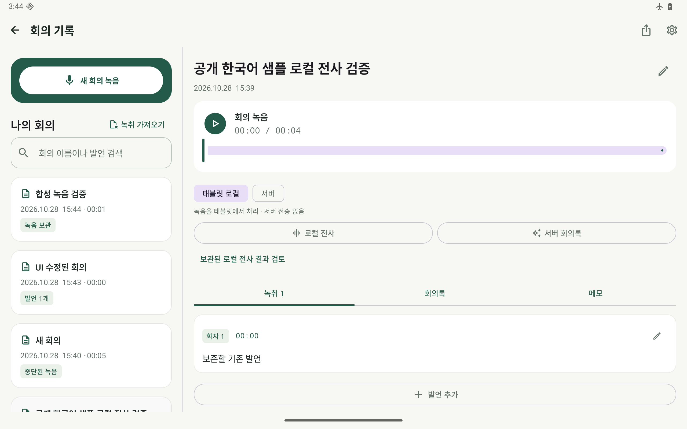
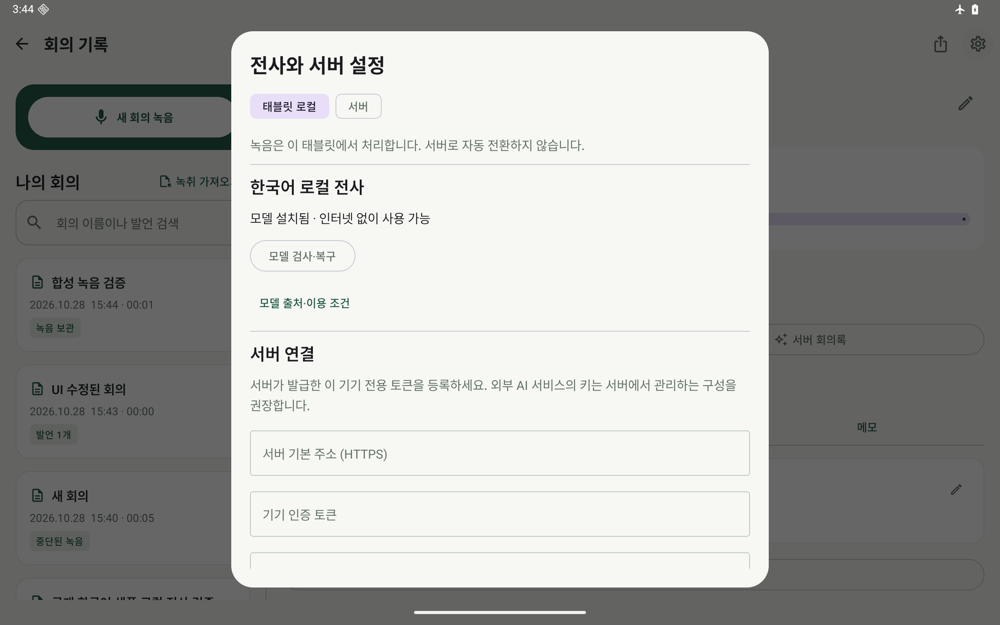

# Android 검증 기록

## 0.3.0 / Fish Audio 0.1.0 — 2026-10-29

JDK 17·AGP 8.13.2·Gradle 8.13·SDK 36에서 두 앱의 debug/release 빌드와 lint를 통과했습니다. Release APK는 별도 배포 키로 서명했고 `debuggable`이 꺼져 있습니다. 기존 0.2.0 debug 키로 서명한 앱에는 직접 업데이트할 수 없습니다.

| 확인 항목 | 결과 |
| --- | --- |
| JVM 테스트 | TableLog 12개, Fish Audio 주소 제한 2개 통과 |
| Python 서버 테스트 | 5개 통과: 인증·만료·재사용·개별 폐기·코드 시도 제한·요청 크기·WAV·전사 계약 |
| 태블릿 에뮬레이터 | API 36 arm64 Pixel Tablet 2560×1600 |
| TableLog 기기 테스트 | 4개 통과: 실제 설정 화면의 맥 선택·코드 연결·Keystore 저장·HTTPS 전사, 회의 편집·복원, 녹음 pause/resume·Activity 재생성, 토큰의 주소 결합 |
| 맥 서버 실제 전사 | 공개 한국어 4.608초 샘플 → Whisper 한국어 문장·시각 반환. 외부 HTTPS에서도 확인. 시험용 기기 토큰은 모두 폐기 |
| 공개 서버 접근 제한 | 무인증 401, 연결 후 모델 목록·전사 200, 기기 폐기 후 403 |
| 모델 비상주 | Whisper는 요청별 자식 프로세스로 실행 후 종료. 웹 API만 상주 |
| Fish Audio 실제 웹 | 화면·목소리 목록·학습 메뉴 전환 통과. 기존 공개 웹과 연결 |
| Fish Audio 실제 스트리밍 | 검증 당시 다른 합성 세션이 사용 중이어서 429를 확인. 기존 세션을 중단하지 않았으며 실제 음성 재생 검증은 보류. 최종 `OK (2 tests)`는 화면 테스트 1개 통과와 스트리밍 1개 assumption skip을 포함 |
| Release 패키징 | 두 APK의 v2 서명·ZIP 16KB 정렬 통과. 비밀 키·서명 비밀번호·사용자 경로·녹음·모델 파일 미포함 검사 |
| Android lint | 두 앱 오류 0. 번역·구버전 속성·의존성 관련 경고는 남음 |

초기 Fish 웹 검증은 에뮬레이터에 남아 있던 비행기 모드 때문에 실패했습니다. 네트워크 복구 후 화면을 확인했으며 합성 요청은 기존 서버 세션의 점유 때문에 거절되었습니다. 이를 스트리밍 성공으로 계산하지 않았습니다. 실제 Lenovo TB376FC, 장시간 녹음·재생, Android 8~15 실행과 OS 절전은 이번에도 미검증입니다. 로컬 음성 엔진은 변경하지 않아 아래 0.2.0 검증을 유지하며 이번에 다운로드·오프라인 모델 추론을 다시 실행하지 않았습니다.

APK SHA-256:

```text
b19f67104184a96b85532e9bdf7f0a78da3ce0c9e15b1d2430a9bd0baff78e5c  TableLog-0.3.0.apk
44ca5156db041f8aa8e9b884dad92f8ef48495921b6d9b6b4116d690c48f6052  FishAudio-0.1.0.apk
```

서명 인증서 SHA-256: `74343d4b90b617bbbb621c1c62ae0a1b27a659d886cbc930803c48dab4eef0bd`.

기존 Fish Audio 웹은 사용자 요청에 따라 인증 없이 유지했습니다. 새 TableLog API의 기기 인증이 기존 Fish 웹까지 보호하는 것은 아닙니다. 앱·서버 전체 침투 테스트 결과가 아니며 공개 APK에서 서버 주소를 알아낼 수 있습니다.

## 0.2.0 — 2026-10-28 기록

검증일: 2026-10-28. 목표 기기는 **레노버 샤오신패드 프로 13(TB376FC), RAM 8GB**입니다. 실제 기기는 연결하지 않았습니다. Android 16/API 36 arm64의 Pixel Tablet 프로필(2560×1600, 실행 RAM 4GB) 에뮬레이터에서 확인했습니다.

## 확인한 결과

| 항목 | 결과 | 확인 범위 |
| --- | --- | --- |
| Debug APK | 통과 | JDK 17, Gradle 8.13, AGP 8.13.2, SDK 36, arm64·x86_64 |
| 서명·패키징 | 통과 | APK v2 서명, ZIP 16KB 정렬, 포함된 모든 native ELF LOAD 정렬 16KB 이상. 16KB 기기 실행 자체는 미검증 |
| Android lint | 오류 0 | API·manifest·리소스 분석. 의존성 갱신·스타일 경고는 남아 있음 |
| JVM 단위 테스트 | 11개 통과 | 기존 JSON·WAV·서버 요청 검사, 모델 이어받기·해시 실패·취소, 인증 실패·리디렉션 차단, native 입력 WAV 형식 검사 |
| 일반 기기 테스트 | 4개 통과, 다운로드 선택 테스트 1개 건너뜀 | 편집·복원·녹음 수명주기, Keystore와 전사 방식 저장, 실제 로컬 음성 엔진·결과 보관 |
| 선택한 다운로드 테스트 | 별도 1개 통과 | 앱의 다운로드 코드로 공개 HTTPS 모델 파일을 실제 내려받고 고정 크기·SHA-256 확인 |
| 오프라인 추론 | 통과 | 비행기 모드, Wi-Fi·셀룰러 비활성화, `Active default network: none` 상태에서 한국어 샘플 전사 |
| 제한된 음성 구간 처리 | 통과 | 48초로 반복한 공개 한국어 음성에서 여러 구간 생성, 각 구간 25초 이내, 전체 시각 범위·순서 확인 |
| 결과 검토·보존 | 통과 | foreground service 전사 완료 후 검토 파일 저장, 기존 발언 미변경, Activity 재생성 후 검토 파일 재읽기 |
| 인증 정보 보호 | 통과 | AES-GCM 저장·복호화, URL 변경 시 동일 토큰 거부, 암호문에 연결된 URL을 바꾸면 복호화 실패, 로컬 모드는 손상된 서버 토큰 없이도 읽힘 |
| 서버 연결 확인 | 모의 HTTPS에서 통과 | GET 모델 목록, Bearer 헤더, 빈 요청 본문, 401·403 구분, 302를 따라 토큰을 전달하지 않음 |
| 녹음 복구 | 통과 | 홈으로 이동해 무음 녹음, 강제 종료 후 PCM 보존·WAV 헤더 복구. 5.0초 checkpoint에서 5.6초 복구 |
| 태블릿 화면 | 확인 | 회의 목록·상세 동시 표시, 로컬/서버 선택, 설정 화면. 화면 압축 변경 후 편집·녹음 테스트 2개 재통과 |

기기 테스트의 `OK (5 tests)`에는 기본적으로 실행하지 않는 다운로드 테스트 1개의 assumption skip이 포함됩니다. 이를 실제 추론이나 다운로드 성공으로 세지 않았습니다. 다운로드는 `downloadModel=true`를 지정한 별도 실행에서 성공했습니다.

## 실제 모델 입력과 결과

사용한 입력은 사용자의 회의가 아닌 [sherpa-onnx 공개 한국어 샘플](https://huggingface.co/csukuangfj/sherpa-onnx-sense-voice-zh-en-ja-ko-yue-2024-07-17/blob/2365baeacb507f821a0c8120fcee3d484dba7a07/test_wavs/ko.wav)입니다. SHA-256은 `0dc797a5c81ed30fc339d91f3da718ab02854e17ffa37cb93c4c039ac5c6bb9c`이며 4.608초, 16kHz mono PCM16입니다. 반복 입력도 이 공개 샘플에서 만들었습니다.

실제 모델은 `조 금만 생각 을 하 면서 살 면 훨씬 편할 거야.`를 반환했습니다. 한국어 출력·시각 범위·저장 흐름을 확인했지만 띄어쓰기 문제도 관찰되었습니다. 정답 회의 자료로 CER·WER를 측정한 결과가 아니며, 장시간 한국어 회의의 정확도를 보장하지 않습니다. 에뮬레이터 실행 시간은 TB376FC 성능으로 제시하지 않습니다.

## 화면





화면에는 합성 회의와 공개 샘플 검증용 기록만 표시했습니다. 녹취의 ‘보존할 기존 발언’은 결과를 자동으로 덮어쓰지 않는지 확인하는 테스트 입력입니다.

## 실행 명령

```bash
./gradlew :app:assembleDebug :app:assembleDebugAndroidTest :app:testDebugUnitTest :app:lintDebug
adb -s emulator-5554 shell am instrument -w work.yunju.tablelog.test/androidx.test.runner.AndroidJUnitRunner
adb -s emulator-5554 shell am instrument -w \
  -e class 'work.yunju.tablelog.LocalAiTest#installFromPublicSourcesWhenExplicitlyRequested' \
  -e downloadModel true work.yunju.tablelog.test/androidx.test.runner.AndroidJUnitRunner
python3 scripts/smoke-recovery.py --serial emulator-5554 --output verification-local/0.2.0-recovery.json
```

실제 추론 테스트는 모델과 샘플을 앱 저장소에 준비해야 합니다. 설치 방법과 경로는 [README](README.md#빌드와-검증)를 참조하세요. Gradle 보고서는 `app/build/reports/`, 복구 결과는 `verification-local/0.2.0-recovery.json`, 에뮬레이터 추론 기록은 앱의 `files/verification/local-smoke.json`입니다. 실행 산출물은 Git에 포함하지 않습니다.

## 아직 확인하지 않은 범위

TB376FC 실기기에서의 장시간 녹음·전사, 최대 메모리, 발열·배터리, 제조사 절전 정책, 실제 마이크·블루투스·오디오 포커스, 세로·분할 창 전환의 전체 사용 흐름은 미검증입니다. Android 8~15와 x86_64 실기기 실행도 확인하지 않았습니다.

운영 서버를 배포하거나 실제 서버의 토큰 발급·폐기·갱신을 검증하지 않았습니다. 코드 승인/OAuth 등록은 설계안입니다. 자동 화자 분리, 로컬 회의록 요약, 실시간 자막과 Play Store 배포도 이번 구현 범위에 포함하지 않습니다.
