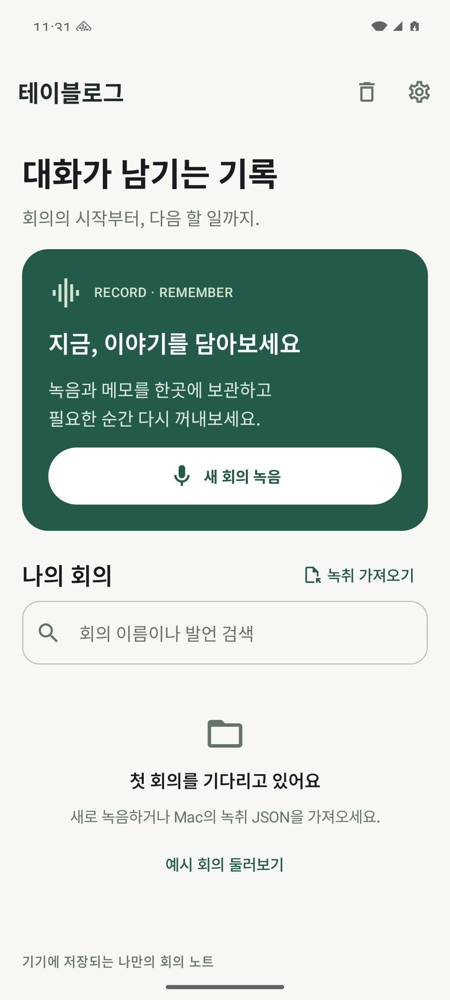
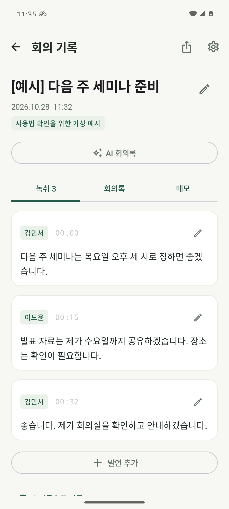

# Android 0.1.0 검증 기록

검증일: 2026-10-28. 합성 발언과 에뮬레이터의 무음 입력만 사용했습니다.

| 항목 | 결과 | 확인한 범위 |
| --- | --- | --- |
| Debug APK 빌드 | 통과 | JDK 17, Gradle 8.13, AGP 8.13.2, SDK 36 |
| Android lint | 오류 0 | 플랫폼 API 호환성·manifest·리소스 분석. 새 의존성 버전 안내와 스타일 권고는 남아 있음 |
| JVM 단위 테스트 | 7개 통과 | JSON 호환, 원문·교정문 선택, 시각·경로 검증, WAV 복구, HTTPS 설정, 청크 시각, 모의 서버 요청·응답 |
| Android 실행 테스트 | 2개 통과 | Pixel 7 프로필, Android 16/API 36, arm64 에뮬레이터 |
| 편집·보관 | 통과 | 제목·발언 수정, 휴지통 이동·복원, 저장소 재읽기, 이전 JSON 보존 |
| 녹음 수명주기 | 통과 | 녹음·일시정지·재개·저장, Activity 재생성 중 녹음 유지, 메모 동시 수정 보존 |
| WAV 저장 | 통과 | 헤더 데이터 길이와 실제 PCM 길이 일치, 기록 샘플 기준 녹음 시간 일치 |
| 백그라운드·프로세스 종료 | 통과 | 홈 화면 이동 후 5초 이상 녹음, force-stop 후 재실행하여 interrupted 상태로 복구 |
| 음성 데이터 복구 | 통과 | 강제 종료 전후 PCM 바이트 동일, WAV 헤더 재작성, 총 5.2초 복구 |
| 화면 확인 | 통과 | 아래 홈·가상 예시 녹취 화면을 실제 에뮬레이터에서 캡처해 확인 |

실행 명령:

```bash
./gradlew :app:testDebugUnitTest :app:lintDebug :app:assembleDebug
./gradlew :app:connectedDebugAndroidTest
python3 scripts/smoke-recovery.py --serial emulator-5554
```

단위 테스트 보고서: `app/build/reports/tests/testDebugUnitTest/`. 기기 테스트 보고서: `app/build/reports/androidTests/connected/debug/`. 강제 종료 테스트 결과: `verification-local/recovery.json`. 빌드와 로컬 검증 출력은 Git에 포함하지 않습니다.

## 화면

| 홈 | 가상 예시 녹취 |
| --- | --- |
|  |  |

## 아직 검증하지 않은 범위

실제 휴대폰 마이크·블루투스·통화 개입·제조사 절전 정책·장시간 녹음, Android 8~15 기기 실행, 운영 AI 서버와 실제 한국어 음성 인식 품질, Play Store 심사·배포는 검증하지 않았습니다. 에뮬레이터 녹음 테스트는 마이크 신호의 품질이나 음성 인식 정확도를 보증하지 않습니다. 모의 서버 테스트는 API 요청 형식과 결과 처리만 검증합니다.
